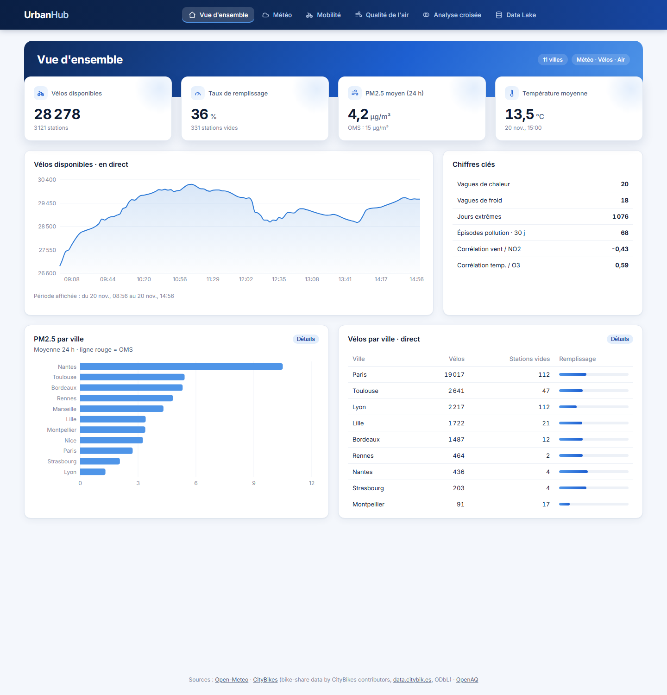
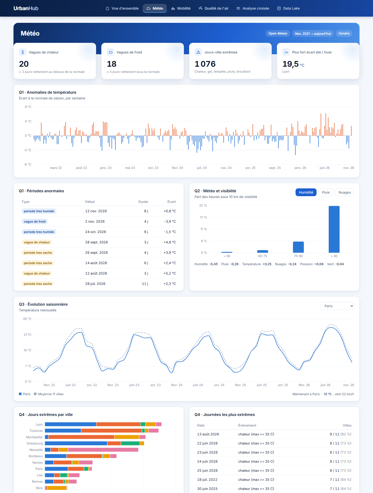
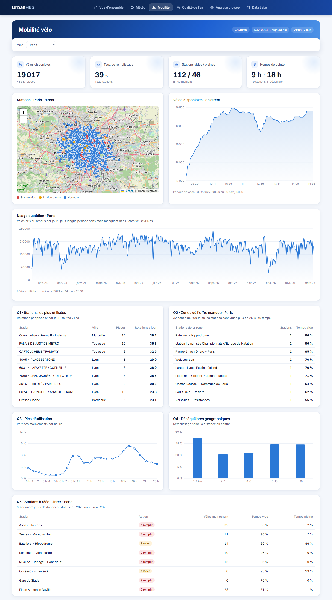
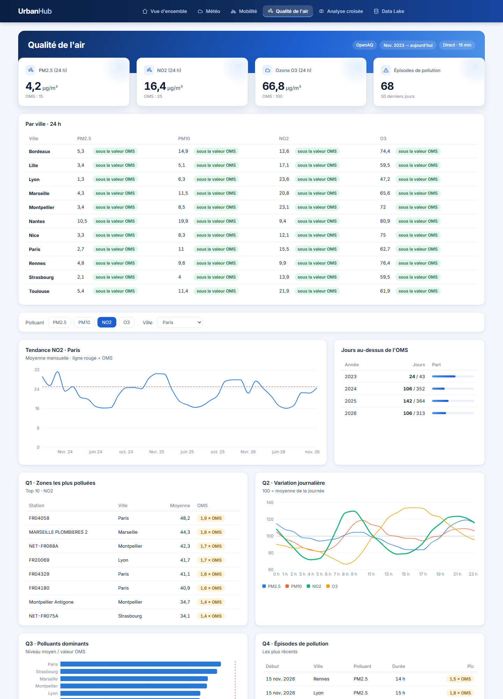
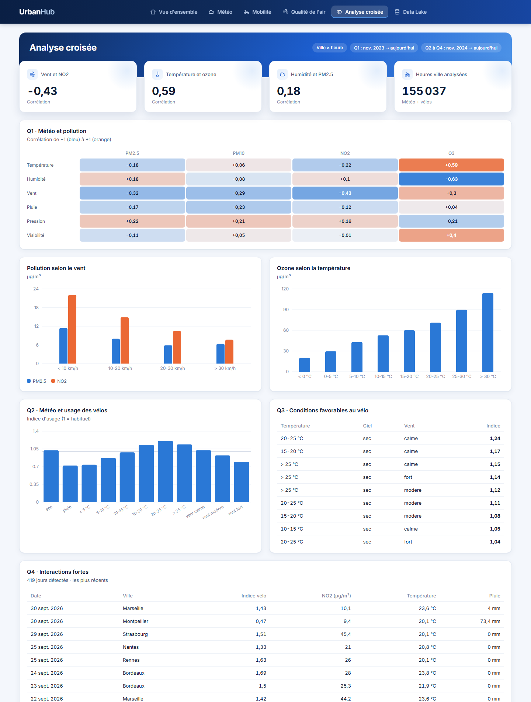
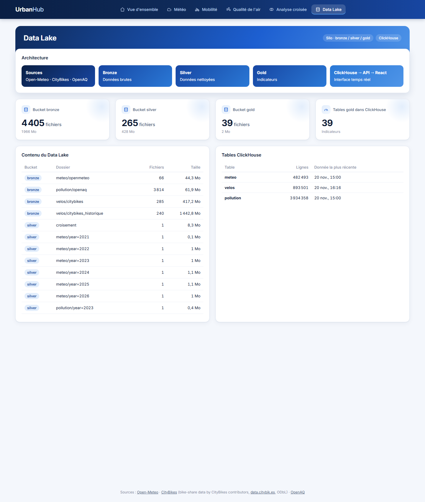

# UrbanHub

UrbanHub est un jumeau numerique urbain. Il recupere des donnees sur les grandes villes francaises (meteo, velos en libre-service, qualite de l'air), les range dans un Data Lake, les nettoie, calcule des indicateurs, puis les affiche dans une interface web qui se met a jour toute seule.

Villes etudiees : Paris, Marseille, Lyon, Toulouse, Nice, Nantes, Strasbourg, Montpellier, Bordeaux, Lille, Rennes.

Ce document explique chaque etape en detail :
- ce qu'elle fait et pourquoi
- dans quel fichier c'est code
- ou arrivent les donnees
- comment regarder les resultats


## Apercu de l'interface

### Vue d'ensemble


### Meteo


### Mobilite velo


### Qualite de l'air


### Analyse croisee


### Data Lake



---

## Sommaire

1. Vue d'ensemble
2. Les outils et les fichiers du projet
3. Installation
4. Lancer tout le projet (le plus simple)
5. Les briques communes
6. Partie 1 - Meteo (flux batch)
7. Partie 2 - Velos (flux streaming)
8. Partie 3 - Pollution (flux IoT)
9. Partie 4 - Analyse croisee
10. ClickHouse, l'API et l'interface React
11. Comment regarder les resultats
12. Resultats et interpretation
13. Limites
14. En cas de probleme


---

## 1. Vue d'ensemble

Le sujet demande trois flux de donnees :

| Flux | Source | Historique | Ensuite |
|---|---|---|---|
| Batch | Open-Meteo | 5 ans, heure par heure (depuis novembre 2021) | mise a jour a chaque passage du pipeline |
| Streaming | CityBikes | depuis novembre 2024 (archive CityBikes, environ 2 ans) | une photo de toutes les stations toutes les 3 min |
| IoT | OpenAQ | 3 ans, heure par heure (depuis novembre 2023) | la derniere mesure de chaque capteur toutes les 15 min |

Les trois flux suivent le meme chemin :

```
Sources (API Open-Meteo, CityBikes, OpenAQ)
   |
   |  1. collecter   : on recupere les donnees et on les depose telles quelles
   v
BRONZE  (Silo, donnees brutes : JSON, CSV)
   |
   |  2. nettoyer    : bonnes variables, bonnes unites, valeurs fausses enlevees
   v
SILVER  (Silo, donnees propres en Parquet)
   |
   |  3. analyser    : indicateurs et reponses aux questions du sujet
   v
GOLD    (Silo, uniquement des TABLEAUX Parquet, aucune image)
   |
   |  4. charger     : ClickHouse lit silver et gold directement dans Silo
   v
CLICKHOUSE  (base OLAP, une table par tableau gold)
   |
   |  5. servir      : une petite API Python lit ClickHouse et renvoie du JSON
   v
INTERFACE REACT  (graphiques et KPI dessines a partir des tableaux, rafraichis automatiquement)
```

En plus de ce chemin, les collecteurs velos et pollution envoient chaque nouvelle collecte **directement dans ClickHouse**. C'est ce qui rend l'interface temps reel : une collecte faite a 15 h 03 est visible a 15 h 03, sans attendre le prochain passage du pipeline.

Pourquoi trois couches dans Silo ?
- **bronze** garde la donnee d'origine. Si on se trompe dans le nettoyage, on peut tout refaire sans retelecharger. Le versioning est active.
- **silver** contient une donnee fiable et rapide a lire. Parquet est un format en colonnes, compresse, standard dans les Data Lakes.
- **gold** contient ce qu'un decideur veut voir : des tableaux d'indicateurs, petits et prets a afficher. Il n'y a plus de graphiques en image : l'interface les dessine elle-meme a partir des tableaux, ce qui permet de les rendre interactifs et a jour.


---

## 2. Les outils et les fichiers du projet

| Outil | Role dans le projet |
|---|---|
| Docker | lance Silo et ClickHouse avec une seule commande |
| Silo | le Data Lake (compatible S3) avec les buckets bronze, silver et gold |
| boto3 | la librairie Python pour parler a Silo (comme au TP Data Lake) |
| pandas + pyarrow | nettoyage, calculs, lecture et ecriture Parquet |
| ClickHouse | base OLAP : SQL tres rapide sur des millions de lignes (comme au TP OLAP) |
| FastAPI | petite API Python entre ClickHouse et l'interface |
| React + Vite | l'interface web |
| Recharts, Leaflet | les graphiques et la carte des stations |

Organisation des fichiers :

```
Projet UrbanHub/
  docker-compose.yml          lance Silo + ClickHouse
  requirements.txt            librairies Python
  .env                        mots de passe et cle OpenAQ (jamais partage)
  .env.example                modele du fichier .env

  urbanhub/                   tout le traitement des donnees (Python)
    config.py                 lit le fichier .env
    villes.py                 les 11 villes + calcul de distance
    datalake.py               lecture / ecriture dans Silo
    gold.py                   enregistre un tableau d'indicateurs dans gold
    olap.py                   connexion a ClickHouse, schema des tables, insertion en direct
    init_datalake.py          cree les buckets
    pipeline.py               lance toute la chaine (une fois ou en boucle)
    charger_clickhouse.py     copie silver et gold dans ClickHouse

    meteo/                    PARTIE 1
      telecharger.py          telechargement parallele Open-Meteo -> bronze
      nettoyer.py             bronze -> silver
      analyser.py             silver -> gold (4 questions)

    velos/                    PARTIE 2
      historique.py           telechargement parallele de l'archive CityBikes -> bronze
      collecter.py            collecte CityBikes toutes les 3 min -> bronze + ClickHouse
      nettoyer.py             bronze -> silver
      analyser.py             silver -> gold (5 questions)

    pollution/                PARTIE 3
      collecter.py            historique 3 ans + flux toutes les 15 min -> bronze (+ ClickHouse)
      nettoyer.py             bronze -> silver
      analyser.py             silver -> gold (4 questions)

    croisement/               PARTIE 4
      analyser.py             croise les 3 sources -> gold (4 questions)

  api/main.py                 l'API qui lit ClickHouse (FastAPI)
  web/                        l'interface React
    src/App.jsx               le menu et les pages
    src/pages/                une page par partie (Accueil, Meteo, Mobilite, Air, Croisement, DataLake)
    src/outils.jsx            appels a l'API, cartes KPI, couleurs
    src/styles.css            le theme bleu
  sql/requetes.sql            exemples de requetes ClickHouse
```


---

## 3. Installation

A faire une seule fois, dans un terminal ouvert dans le dossier du projet.

**Etape 1 : Python**

```
py -m venv .venv
.venv\Scripts\activate
pip install -r requirements.txt
```

`.venv` est un environnement Python propre au projet. Il faut l'activer (deuxieme ligne) a chaque nouveau terminal. On sait qu'il est actif quand `(.venv)` apparait au debut de la ligne.

**Etape 2 : l'interface (Node.js doit etre installe)**

```
cd web
npm install
npm run build
cd ..
```

`npm run build` fabrique l'interface dans `web/dist`. L'API la sert ensuite directement.

**Etape 3 : le fichier .env**

```
copy .env.example .env
```

Remplir `OPENAQ_API_KEY=` avec la cle OpenAQ (gratuite sur explore.openaq.org). Ce fichier est exclu de git.

**Etape 4 : l'infrastructure**

Demarrer Docker Desktop, puis :

```
docker compose up -d
python -m urbanhub.init_datalake
```

Cela lance deux conteneurs :
- `urbanhub-minio` : API S3 sur le port 9010, console web sur http://127.0.0.1:9011
- `urbanhub-clickhouse` : port 8123, interface SQL sur http://127.0.0.1:8123/play

Remarques :
- Ports 9010 et 9011 (et non 9000 et 9001) pour ne pas gener le stockage des TP s'il tourne encore.
- Silo tourne avec l'image Docker `pgsty/minio` (l'image `minio/minio` n'est plus publiee).
- Les donnees sont dans un volume Docker, pas dans le dossier du projet (qui est dans OneDrive).


---

## 4. Lancer tout le projet (le plus simple)

**En un double-clic :** `demarrer.bat`. Il lance Silo et ClickHouse, ouvre une fenetre pour chaque programme (collecteur velos, collecteur pollution, pipeline toutes les heures, interface) et ouvre http://localhost:8000. L'interface se met alors a jour toute seule : une nouvelle collecte velos toutes les 3 minutes, pollution toutes les 15 minutes, indicateurs gold toutes les heures. Pour arreter, fermer les fenetres.

Attention : ne lancer `demarrer.bat` qu'une fois. Deux collecteurs velos en meme temps depassent la limite de CityBikes et bloquent la collecte.

Avant le tout premier lancement, il faut recuperer l'historique (terminal 1 ci-dessous).

**A la main**, il faut 4 terminaux (tous avec `.venv\Scripts\activate`).

**Terminal 1 : l'historique (une seule fois, environ 30 minutes)**

```
python -m urbanhub.meteo.telecharger
python -m urbanhub.pollution.collecter --historique 3
python -m urbanhub.velos.historique
```

**Terminal 2 : le collecteur velos (a laisser tourner)**

```
python -m urbanhub.velos.collecter
```

**Terminal 3 : le collecteur pollution (a laisser tourner)**

```
python -m urbanhub.pollution.collecter
```

**Terminal 4 : le pipeline puis l'interface**

```
python -m urbanhub.pipeline
uvicorn api.main:app --port 8000
```

Puis ouvrir **http://localhost:8000**.

Pour que les indicateurs gold se recalculent tout seuls toutes les heures, lancer le pipeline en boucle dans un terminal a part :

```
python -m urbanhub.pipeline --boucle 3600
```

Ce que fait le pipeline ([urbanhub/pipeline.py](urbanhub/pipeline.py)), dans l'ordre :
1. met a jour la meteo jusqu'a aujourd'hui, la nettoie, l'analyse
2. recupere les nouveaux mois de l'historique velos, nettoie et analyse les velos
3. nettoie et analyse la pollution
4. fait l'analyse croisee
5. charge silver et gold dans ClickHouse

Chaque etape est un script independant, on peut aussi les lancer un par un (voir les parties suivantes).


---

## 5. Les briques communes

### config.py : les parametres

[urbanhub/config.py](urbanhub/config.py) lit le fichier `.env` : adresse et mots de passe de Silo et ClickHouse, cle OpenAQ.

### villes.py : les villes

[urbanhub/villes.py](urbanhub/villes.py) contient les 11 villes avec leurs coordonnees et la fonction `distance_km` (formule de haversine). Elle sert a rattacher un capteur a sa ville et a mesurer la distance d'une station de velos au centre-ville.

### datalake.py : parler a Silo

[urbanhub/datalake.py](urbanhub/datalake.py) regroupe tout ce qui touche a Silo avec boto3 :
- `init_buckets` cree bronze, silver, gold et active le versioning sur bronze
- `put_json`, `put_parquet`, `put_bytes` ecrivent un fichier
- `get_json`, `get_parquet`, `lister`, `lire_parquets` lisent

### gold.py : enregistrer un indicateur

[urbanhub/gold.py](urbanhub/gold.py), fonction `sauver_table(df, partie, nom)` : enregistre un tableau dans `gold/<partie>/<nom>.parquet`. Chaque analyse l'appelle pour chacun de ses resultats.

### olap.py : parler a ClickHouse

[urbanhub/olap.py](urbanhub/olap.py) :
- `SCHEMAS` decrit les trois tables detaillees (meteo, velos, pollution)
- `inserer(table, df)` ajoute des lignes ; les collecteurs l'utilisent pour le temps reel. Si ClickHouse est arrete, la collecte continue quand meme (les donnees restent dans Silo).
- les tables velos et pollution utilisent le moteur `ReplacingMergeTree` : si une meme mesure arrive deux fois (une fois par le collecteur, une fois par le chargement), ClickHouse n'en garde qu'une.


---

## 6. Partie 1 - Meteo (flux batch)

Source : Open-Meteo, gratuit et sans cle. Il remplace NOAA, qui est abandonne.

### Etape 1.1 : telecharger en parallele

```
python -m urbanhub.meteo.telecharger
```

Code : [urbanhub/meteo/telecharger.py](urbanhub/meteo/telecharger.py)

- On veut les 5 dernieres annees jusqu'a aujourd'hui, heure par heure, pour les 11 villes.
- Une requete = une ville x une annee, soit 66 requetes. Elles partent **en parallele** avec `ThreadPoolExecutor` (4 a la fois, reglable avec `--workers`).
- Chaque requete interroge deux API d'Open-Meteo :
  - l'API "archive" (reanalyse ERA5) : temperature, humidite, pluie, vent, direction du vent, rafales, pression, nuages
  - l'API "historical forecast" : la visibilite, absente de l'archive
- Les annees passees deja telechargees ne sont pas reprises. L'annee en cours est toujours retelechargee pour aller jusqu'a aujourd'hui.

Resultat dans Silo :
```
bronze/meteo/openmeteo/ville=Paris/year=2024.json
```

### Etape 1.2 : nettoyer

```
python -m urbanhub.meteo.nettoyer
```

Code : [urbanhub/meteo/nettoyer.py](urbanhub/meteo/nettoyer.py)

- renomme les colonnes : station_id, city, timestamp, temperature, humidity, precipitation, wind_speed, wind_direction, wind_gusts, pressure, cloud_cover, visibility
- visibilite convertie de metres en km
- valeurs impossibles enlevees (`BORNES`, ex : temperature hors de -40 a 50 C)
- petits trous de 3 heures maximum bouches par interpolation
- heures futures et doublons enleves

Resultat : un Parquet par annee, `silver/meteo/year=2024/meteo.parquet`. Au total environ 482 000 heures.

### Etape 1.3 : analyser

```
python -m urbanhub.meteo.analyser
```

Code : [urbanhub/meteo/analyser.py](urbanhub/meteo/analyser.py). On fabrique d'abord un tableau journalier par ville (`charger`), puis :

| Question | Fonction | Methode | Tableaux gold |
|---|---|---|---|
| Q1 periodes anormales | `q1_anomalies` | ecart a la "normale" du meme jour de l'annee ; vague = au moins 3 jours a plus de 1,5 ecart-type ; meme idee pour la pluie sur 30 jours | `q1_anomalies_journalieres`, `q1_periodes_anormales` |
| Q2 meteo et visibilite | `q2_visibilite` | correlation de Spearman avec la visibilite ; part des heures sous 10 km selon pluie, humidite, nuages | `q2_correlations`, `q2_visibilite_par_condition` |
| Q3 saisons | `q3_saisons` | temperature mensuelle par ville et moyenne des 11 villes ; ecart ete / hiver | `q3_temperature_mensuelle`, `q3_profil_saisonnier`, `q3_ecart_ete_hiver` |
| Q4 jours extremes | `q4_extremes` | chaleur (max 35 C ou plus), gel (min -5 C ou moins), tempete (rafales 80 km/h ou plus), forte pluie (30 mm ou plus), brouillard (6 h ou plus sous 1 km) | `q4_jours_extremes`, `q4_extremes_par_mois`, `q4_extremes_par_ville` |

Plus `meteo_journaliere` (une ligne par ville et par jour). Tout est dans `gold/meteo/`.


---

## 7. Partie 2 - Velos (flux streaming)

Source : CityBikes, qui regroupe les reseaux de velos en libre-service (Velib, Velo'v, ...). Deux services :
- **l'API**, qui ne donne que l'etat actuel des stations (aucune date ne peut etre demandee) : c'est le flux streaming
- **l'archive** https://data.citybik.es, un fichier Parquet par reseau et par mois, ou chaque ligne est un changement d'etat d'une station. Elle commence en **novembre 2024** : c'est tout l'historique qui existe, on ne peut pas remonter a 3 ans.

Licence de l'archive : ODbL. Mention obligatoire, reprise dans l'interface : "Bike-share data by CityBikes contributors and available from https://data.citybik.es".

### Etape 2.1 : recuperer l'historique (une fois, puis chaque mois)

```
python -m urbanhub.velos.historique
```

Code : [urbanhub/velos/historique.py](urbanhub/velos/historique.py)

- liste les fichiers de l'archive pour nos 12 reseaux (`RESEAUX`) depuis 3 ans
- les telecharge **en parallele** (4 a la fois), environ 1,4 Go pour 240 fichiers
- les depose dans bronze : `bronze/velos/citybikes_historique/network=velib/year=2025/month=03.parquet`
- les mois deja recuperes ne sont pas repris ; le pipeline relance ce script et ajoute chaque nouveau mois publie

### Etape 2.2 : collecter en continu

```
python -m urbanhub.velos.collecter
```

Code : [urbanhub/velos/collecter.py](urbanhub/velos/collecter.py)

- Toutes les 3 minutes, on interroge les reseaux des grandes villes (`reseaux_france`, liste rafraichie chaque heure).
- Les reseaux sont interroges en parallele (`ThreadPoolExecutor`).
- Une collecte = une "photo" de toutes les stations, deposee dans bronze :
  `bronze/velos/citybikes/year=2026/month=11/day=19/snapshot_20261119T143000.json`
- La meme photo, nettoyee (`nettoyer_snapshots`), est aussitot inseree dans la table ClickHouse `velos`. C'est le temps reel.
- CityBikes autorise 300 requetes par heure. Si on depasse, l'API repond "429" avec un delai d'attente ; le collecteur fait une pause de ce delai puis reprend tout seul.

### Etape 2.3 : nettoyer

```
python -m urbanhub.velos.nettoyer
```

Code : [urbanhub/velos/nettoyer.py](urbanhub/velos/nettoyer.py). Deux tables sont produites dans silver :

1. `silver/velos/date=2026-11-19/velos.parquet` : les photos du collecteur, une ligne par station et par collecte (station_id, station_name, latitude, longitude, collected_at, bikes_available, free_slots, capacity, fill_rate). Lignes sans identifiant ou sans position enlevees, valeurs negatives effacees, doublons enleves. Sert au temps reel.

2. `silver/velos_horaire/month=2025-03/network=velib.parquet` : **une ligne par station et par heure**, historique et collecte reunis (fonction `vers_horaire`). Pour chaque station on reconstitue l'etat tous les quarts d'heure (dernier etat connu), puis on calcule pour chaque heure : velos et places moyens, taux de remplissage, part du temps ou la station est vide ou pleine, et les **mouvements** (variations du nombre de velos = velos pris ou rendus). Le calcul se fait en tableaux numpy (temps x stations) : un mois de Velib, soit 3 millions de changements d'etat, prend environ 20 secondes. Quand l'archive et la collecte couvrent le meme mois, l'archive est prioritaire.

### Etape 2.4 : analyser

```
python -m urbanhub.velos.analyser
```

Code : [urbanhub/velos/analyser.py](urbanhub/velos/analyser.py)

La table horaire fait des dizaines de millions de lignes : l'analyse la lit fichier par fichier (un reseau x un mois) et ne garde en memoire que des totaux (fonction `accumuler`). Les "mouvements" sont notre mesure de l'utilisation. Les reseaux qui ne publient pas le nombre de velos (toujours 0) sont ignores.

| Question | Fonction | Tableaux gold |
|---|---|---|
| Q1 stations les plus utilisees | `q1_utilisation` (rotations = mouvements / capacite / jour) | `q1_top_stations`, `q1_utilisation_par_ville` |
| Q2 offre insuffisante | `q2_offre_insuffisante` (carres de 500 m vides plus de 25 % du temps, stations hors service exclues) | `q2_zones_insuffisantes` |
| Q3 pics dans la journee | `q3_pics` | `q3_profil_horaire`, `q3_heure_de_pointe`, `q3_semaine_weekend` |
| Q4 desequilibres geographiques | `q4_desequilibres` (remplissage selon la distance au centre, matin contre soir) | `q4_remplissage_par_distance`, `q4_matin_soir` |
| Q5 stations a reequilibrer | `q5_critiques` (vides ou pleines plus de 30 % du temps sur les 30 derniers jours de donnees de chaque ville) | `q5_stations_critiques` |
| tendance | `usage_journalier` | `velos_journalier` (mouvements par ville et par jour) |


---

## 8. Partie 3 - Pollution (flux IoT)

Source : OpenAQ, qui rassemble les mesures des capteurs de qualite de l'air. Polluants : PM2.5, PM10, O3, NO2, CO.

### Etape 3.1 : collecter

Code : [urbanhub/pollution/collecter.py](urbanhub/pollution/collecter.py)

Dans les deux modes, on commence par chercher les capteurs actifs a moins de 25 km de chaque ville (`chercher_capteurs`, avec la cle API). La liste est gardee dans `bronze/pollution/openaq/reference/capteurs.json`.

**Historique, une seule fois :**

```
python -m urbanhub.pollution.collecter --historique 3
```

- OpenAQ publie tout son historique dans un depot public sur AWS S3 (`openaq-data-archive`), un fichier par station et par jour. Pas de limite de requetes, pas besoin de cle.
- Fonction `collecte_historique` : pour chaque station et chaque mois des 3 dernieres annees, on telecharge les fichiers jour **en parallele** (24 a la fois) et on les met bout a bout en un seul fichier par mois :
  `bronze/pollution/openaq/historique/location=2681/year=2024/month=05.csv.gz`
- Les mois termines deja recuperes ne sont pas repris. Le mois en cours est toujours mis a jour.

**Flux temps reel, en continu :**

```
python -m urbanhub.pollution.collecter
```

- Toutes les 15 minutes, `collecte_flux` lit la derniere mesure de chaque station via l'API (60 requetes par minute maximum, respecte par la fonction `appel`).
- La reponse brute va dans `bronze/pollution/openaq/flux/year=.../snapshot_....json`.
- Les mesures nettoyees vont aussitot dans la table ClickHouse `pollution`.

### Etape 3.2 : nettoyer

```
python -m urbanhub.pollution.nettoyer
```

Code : [urbanhub/pollution/nettoyer.py](urbanhub/pollution/nettoyer.py)

- historique et flux regroupes au meme format : sensor_id, pollutant, value, unit, latitude, longitude, timestamp, city, location_name
- l'archive date la fin de l'heure mesuree et l'API son debut : on retire 1 heure a l'archive pour aligner les deux
- les fichiers de l'archive sont en latin-1 et chaque fichier jour repete sa ligne d'en-tete : c'est corrige a la lecture
- tout est converti en microgrammes par m3 (certains capteurs donnent des ppm ou ppb)
- valeurs negatives ou impossibles enlevees, doublons enleves
- dans le flux, une mesure vieille de plus de 2 jours est ignoree (capteur en panne)

Resultat : un Parquet par annee, `silver/pollution/year=2025/pollution.parquet`. Au total environ 3,9 millions de mesures horaires.

### Etape 3.3 : analyser

```
python -m urbanhub.pollution.analyser
```

Code : [urbanhub/pollution/analyser.py](urbanhub/pollution/analyser.py)

Les polluants ne se comparent pas directement : on rapporte chaque concentration a la valeur guide de l'OMS 2021 (PM2.5 : 15, PM10 : 45, NO2 : 25, O3 : 100, CO : 4000 microgrammes par m3). Un rapport de 2 veut dire "2 fois la valeur conseillee".

| Question | Fonction | Tableaux gold |
|---|---|---|
| tendance sur 3 ans | `series_journalieres` | `pollution_journaliere`, `jours_depassement_oms` |
| Q1 zones les plus polluees | `q1_zones` | `q1_niveaux_par_zone` |
| Q2 variation dans la journee | `q2_journee` | `q2_profil_horaire`, `q2_no2_semaine_weekend` |
| Q3 polluants dominants | `q3_dominants` | `q3_ratio_oms_par_ville`, `q3_polluants_dominants` |
| Q4 episodes anormaux | `q4_episodes` (au moins 6 h au-dessus de la valeur OMS ou d'un niveau exceptionnel pour la ville) | `q4_episodes`, `q4_episodes_par_mois` |


---

## 9. Partie 4 - Analyse croisee

```
python -m urbanhub.croisement.analyser
```

Code : [urbanhub/croisement/analyser.py](urbanhub/croisement/analyser.py)

On construit une table "une ligne = une ville x une heure" (`construire_table`) qui rassemble la meteo, la moyenne de chaque polluant et l'usage des velos. Elle est rangee dans `silver/croisement/table_ville_heure.parquet`.

Pour l'usage des velos, on calcule un "indice d'usage" : 1,2 veut dire "20 % de plus que d'habitude a cette heure-la, ce jour-la de la semaine, dans cette ville". Cela enleve l'effet de l'heure de pointe.

| Question | Fonction | Tableaux gold |
|---|---|---|
| Q1 meteo et pollution | `q1_meteo_pollution` | `q1_correlation_meteo_pollution`, `q1_pollution_selon_vent`, `q1_pollution_selon_temperature` |
| Q2 meteo et usage des velos | `q2_meteo_velos` | `q2_correlation_meteo_velos`, `q2_usage_selon_meteo` |
| Q3 conditions favorables au velo | `q3_favorables` | `q3_conditions_favorables` |
| Q4 interactions fortes | `q4_interactions` | `q4_ecarts_journaliers`, `q4_jours_interaction_forte` |

Grace a l'archive CityBikes, les velos couvrent environ 2 ans : Q2, Q3 et Q4 portent sur toute cette periode.


---

## 10. ClickHouse, l'API et l'interface React

### Chargement dans ClickHouse

```
python -m urbanhub.charger_clickhouse
```

Code : [urbanhub/charger_clickhouse.py](urbanhub/charger_clickhouse.py). ClickHouse lit directement les Parquet dans Silo avec la fonction `s3()` :
- `silver/meteo`, `silver/velos`, `silver/pollution` deviennent les tables `urbanhub.meteo`, `urbanhub.velos`, `urbanhub.pollution`
- `silver/velos_horaire` devient la table `urbanhub.velos_horaire` (l'historique velos station x heure)
- chaque tableau gold devient une table : `gold/meteo/q1_periodes_anormales.parquet` donne `urbanhub.gold_meteo_q1_periodes_anormales`

Il y a 39 tables gold. Pour les voir : `SHOW TABLES FROM urbanhub` dans http://127.0.0.1:8123/play. Des exemples de requetes sont dans [sql/requetes.sql](sql/requetes.sql).

### L'API

```
uvicorn api.main:app --port 8000
```

Code : [api/main.py](api/main.py). Elle fait le lien entre ClickHouse et l'interface :

| Route | Ce qu'elle renvoie |
|---|---|
| `/api/kpis` | les indicateurs cles de la page d'accueil |
| `/api/gold/<nom>` | une table gold, ex : `/api/gold/meteo_q1_periodes_anormales` |
| `/api/velos/live` | l'etat actuel des velos par ville (derniere collecte) |
| `/api/velos/evolution` | les velos disponibles a chaque collecte des dernieres 24 h |
| `/api/velos/stations?city=Paris` | chaque station avec sa position (pour la carte) |
| `/api/pollution/live` | la pollution des dernieres 24 h par ville et polluant |
| `/api/meteo/live` | la derniere heure meteo connue par ville |
| `/api/datalake` | le contenu des buckets Silo |
| `/api/etat` | la fraicheur des donnees |

On peut ouvrir ces adresses dans le navigateur pour voir le JSON, ex : http://localhost:8000/api/kpis. La documentation automatique est sur http://localhost:8000/docs.

### L'interface

Code : [web/src](web/src). Six pages dans le menu en haut (captures au debut de ce document) :

| Page | Contenu |
|---|---|
| Vue d'ensemble | KPI en direct (velos, remplissage, PM2.5, temperature), courbe des velos sur 24 h, PM2.5 par ville, points cles |
| Meteo | Q1 a Q4 de la partie 1 |
| Mobilite velo | carte des stations en direct, courbe 24 h, Q1 a Q5 de la partie 2 (choix de la ville) |
| Qualite de l'air | tableau en direct ville par ville, tendance sur 3 ans, Q1 a Q4 de la partie 3 (choix du polluant et de la ville) |
| Analyse croisee | Q1 a Q4 de la partie 4 |
| Data Lake | l'architecture et le contenu de Silo et ClickHouse |

Les donnees en direct se rechargent toutes les 30 a 60 secondes, les indicateurs gold toutes les 5 a 10 minutes. Il n'y a pas besoin de recharger la page.

Pour modifier l'interface, lancer `npm run dev` dans `web/` (en plus de l'API) et ouvrir http://localhost:5173 : chaque modification s'affiche tout de suite. Ensuite `npm run build` pour mettre a jour la version servie sur le port 8000.


---

## 11. Comment regarder les resultats

| Ou | Adresse | Ce qu'on y voit |
|---|---|---|
| Interface UrbanHub | http://localhost:8000 | tout, en graphiques et KPI |
| Console Silo | http://127.0.0.1:9011 (urbanhub / urbanhub123) | les fichiers bronze, silver, gold |
| ClickHouse | http://127.0.0.1:8123/play (urbanhub / urbanhub123) | les tables, en SQL |
| API | http://localhost:8000/docs | les donnees brutes envoyees a l'interface |
| Terminaux des collecteurs | | une ligne par collecte, ex : `14:41:00 UTC  12 reseaux, 3352 stations, 3352 lignes vers ClickHouse` |

Pour voir le temps reel en action : laisser l'interface ouverte sur "Mobilite velo". Toutes les 3 minutes, le collecteur ecrit une ligne dans son terminal, et l'heure "Derniere collecte" de la page change.


---

## 12. Resultats et interpretation

### Partie 1 - Meteo (novembre 2021 a novembre 2026)

**Q1 periodes anormales.** 20 vagues de chaleur (85 jours au total), 18 vagues de froid (80 jours), 7 periodes tres seches et 11 tres humides. 2026 se detache nettement : 6 vagues de chaleur pour 35 jours, contre 7 a 15 jours les autres annees, avec l'ecart a la normale le plus fort (+5,4 C en moyenne).

**Q2 visibilite.** C'est l'humidite qui reduit le plus la visibilite (correlation -0,45), avant la pluie (-0,26) et les nuages (-0,24). Quand l'humidite depasse 90 %, la visibilite tombe sous 10 km pendant 22 % des heures, contre moins de 1 % par air sec. Le vent et la pression n'ont presque aucun effet.

**Q3 saisons.** Toutes les villes suivent le meme cycle, mais l'amplitude change : Lyon a le plus grand ecart ete / hiver (19,5 C), suivie de Montpellier et Strasbourg (climat continental ou chaleur mediterraneenne l'ete). Les villes atlantiques, Rennes (13,8 C) et Nantes (14,3 C), sont les plus douces grace a l'ocean.

**Q4 jours extremes.** 1 075 jours-ville extremes en 5 ans. La chaleur arrive en tete (386), devant le brouillard (320), les tempetes (185), les fortes pluies (127) et le gel (57). Le 13 aout 2026 est le jour le plus extreme : 9 villes sur 11 au-dessus de 35 C.

### Partie 2 - Velos (novembre 2024 a novembre 2026, 3 830 stations)

**Q1 stations les plus utilisees.** Lyon et Toulouse ont les velos les plus sollicites (6,4 et 5,6 rotations par place et par jour en moyenne), devant Paris (3,7). Strasbourg et Montpellier tournent beaucoup moins (moins de 1). Les stations les plus actives sont pres des noeuds de transport et des centres : Part-Dieu et Guillotiere a Lyon, Palais de Justice a Toulouse, Cours Julien a Marseille.

**Q2 offre insuffisante.** 119 zones de 500 m ont des stations vides plus d'un quart du temps, surtout a Paris (32), Toulouse (31) et Lyon (24). Ce sont les endroits ou il manque des velos. Les stations vides 99 % du temps ou plus sont considerees hors service et ne sont pas comptees.

**Q3 pics.** Deux pics nets en semaine : le matin vers 8-9 h et surtout le soir vers 17-18 h (trajets domicile-travail). Le week-end, l'usage est plus etale sur l'apres-midi.

**Q4 desequilibres.** A Paris, les stations du centre (0-2 km) sont remplies a 52 % en moyenne contre 32 % entre 2 et 6 km : les velos s'accumulent au centre. A Lyon c'est l'inverse, la peripherie est plus pleine. Strasbourg a des stations tres remplies partout (velos peu utilises).

**Q5 a reequilibrer.** Sur les 30 derniers jours de donnees de chaque ville (l'archive CityBikes s'arrete pour l'instant fin septembre 2026, on y ajoute la collecte en direct), 339 stations sont vides ou pleines plus de 30 % du temps : 298 a remplir et 41 a vider, dont 79 a Paris. Les stations hors service sont exclues. Le tableau de l'interface donne la liste, avec l'action (remplir ou vider) et la periode utilisee.

### Partie 3 - Pollution (novembre 2023 a novembre 2026)

**Q1 zones les plus polluees.** Les stations de trafic des grandes villes ont les niveaux de NO2 les plus eleves : une station de Paris depasse en moyenne 48 microgrammes par m3, presque 2 fois la valeur OMS, suivie de Marseille et Montpellier.

**Q2 journee.** Le NO2 a un pic le matin vers 9 h (trafic) et baisse le week-end (pic a 24 contre 30 microgrammes par m3 en semaine). L'ozone fait l'inverse : maximum vers 16 h, quand le soleil est le plus fort. Les particules fines remontent le soir (chauffage, air plus stable la nuit).

**Q3 polluants dominants.** Le NO2 domine dans 7 villes sur 11 (Paris en tete, a 0,92 fois la valeur OMS en moyenne). L'ozone domine a Bordeaux et Nantes, les PM2.5 a Lille et Rennes. Paris depasse la valeur OMS du NO2 environ 1 jour sur 3.

**Q4 episodes.** 2 812 episodes detectes en 3 ans. Le NO2 en concentre le plus a Paris, Strasbourg et Marseille ; l'ozone surtout a Nice et Strasbourg, en ete.

### Partie 4 - Croisement

**Q1 meteo et pollution (3 ans, 11 villes).** Le vent est le meilleur "nettoyeur" de l'air : correlation -0,43 avec le NO2 et -0,32 avec les PM2.5. Par vent faible, le NO2 moyen est environ 3 fois plus eleve que par vent fort. La temperature favorise l'ozone (+0,59) : il passe de 20 microgrammes par m3 sous 0 C a 114 au-dessus de 30 C. L'air humide va avec peu d'ozone (-0,63).

**Q2 meteo et velos.** La temperature est le facteur le plus fort (+0,34). L'usage passe de 0,74 (moins de 5 C) a 1,21 (20 a 25 C), soit 64 % de velos en plus. La pluie fait chuter l'usage d'environ 30 % (indice 0,72) et le vent fort de 20 % (0,80).

**Q3 conditions favorables.** Le meilleur temps pour le velo : 20 a 25 C, sec et sans vent (24 % d'usage en plus que d'habitude), puis 15 a 20 C sec et calme. Au-dela de 25 C, l'usage baisse un peu.

**Q4 interactions fortes.** 419 jours-ville ou l'usage des velos, le NO2 et la meteo s'ecartent tous fortement de la normale en meme temps. Le cas le plus frequent (182 jours) : un jour froid (4 C en moyenne), sec et sans vent, ou les velos sortent peu et ou le NO2 grimpe, car l'air froid et immobile garde la pollution au sol (episode hivernal). A l'oppose, 99 jours pluvieux et venteux combinent peu de velos et un air propre.


---

## 13. Limites

- **Velos : environ 2 ans au lieu de 3.** L'API CityBikes ne donne que l'etat actuel ; leur archive commence en novembre 2024 et il n'existe rien avant. Quelques mois manquent selon les reseaux, et le dernier mois n'est publie qu'au debut du mois suivant (la collecte en direct comble ce trou).
- Marseille renvoie toujours 0 velo et Nice n'a pas de station dans CityBikes : ces deux villes sont absentes des analyses velos.
- La meteo Open-Meteo est une reanalyse (modele recale sur les mesures), pas la mesure d'une station. Elle est tres fiable pour les tendances, un peu lissee pour les extremes locaux. La visibilite vient d'un modele de prevision et plafonne a 24 km.
- Les capteurs OpenAQ ne sont pas les memes partout : certaines villes n'ont pas de mesure de CO ou d'ozone.


---

## 14. En cas de probleme

| Probleme | Solution |
|---|---|
| `Could not connect to the endpoint URL` | Silo n'est pas lance : `docker compose up -d` |
| L'interface affiche "Pas encore de donnees" | lancer `python -m urbanhub.pipeline` |
| La page http://localhost:8000 est blanche ou introuvable | lancer `npm run build` dans `web/`, puis relancer l'API |
| Le collecteur velos affiche "429" ou "API saturee" | limite CityBikes atteinte : il fait une pause tout seul. Ne pas lancer deux collecteurs velos en meme temps. |
| `Cle OpenAQ manquante` | remplir `OPENAQ_API_KEY` dans `.env` |
| `ClickHouse indisponible` dans un collecteur | ClickHouse est arrete. La collecte continue dans Silo ; relancer ClickHouse puis `python -m urbanhub.charger_clickhouse` |
